## General

BSI is a Bayesian statistical analysis tool that calculates and visualizes statistical intervals and posterior predictive distributions from uploaded MCMC output data. Users select fixed effects and variance components, defining a Linear Mixed Model in order to generate credible, prediction, and tolerance intervals with adjustable confidence levels. Two-sided tolerance intervals can be reduced to ordinary intervals with the method of Krishnamoorthy and Mathew (2009). The app supports both normal and log-normal data, provides interactive visualizations, and includes comprehensive error handling. The interface is organized into tabs that guide users through the data analysis workflow from data preview to final statistical visualizations. This documentation aims to provide the user with an understanding of the working principles behind this app, and create an easy user and developer manual.

Version 3.0 of this documentation describes the application as part of the R package **bayesintervals**. All calculations of the application are also available as R functions (see the library user guide, section 3).

### Names

The package and its interactive application have different names:

| | Name | How to get it |
|---|---|---|
| R package | `bayesintervals` | `library(bayesintervals)` |
| Shiny application | **BSI** (*Bayesian Statistical Intervals*) | `start_app_view()` |
| GitHub repository | `BayesianSI.Calculator` | <https://github.com/Sanofi-Public/BayesianSI.Calculator> |

: Names {.striped}

```{r}
#| eval: false
library(bayesintervals)
start_app_view()      # starts the BSI application in your browser
```

### Example data {#sec-data}

The examples of this documentation use two small files with MCMC output (draws from a Gibbs sampler) in the folder `example_data`. They come from an invented two-arm study with a continuous marker and a baseline covariate. The sampler was run on simulated observations, so the files look like the output of a Bayesian software package: one row per MCMC draw, one column per model parameter. **All data in this documentation are simulated.**

| File | Contents |
|---|---|
| `example_by_week_mcmc.csv` | One analysis per week (2, 4, 8, 12, 16, 24), stacked; 1,750 draws per week. Columns: `Week`, `Iteration`, `Intercept`, `Baseline`, `TreatB`, `Residual.Var`. |
| `example_repeated_measures_mcmc.csv` | One analysis of four visits with a random patient effect; 5,000 draws. Columns: `Iteration`, `Intercept`, `Baseline`, `TreatB`, `Visit2`-`Visit4`, `TreatB.Visit2`-`TreatB.Visit4`, `Random.Var`, `Residual.Var`. |

: Example files {.striped}

Your own files need the same structure: numeric columns for the model parameters (fixed effects, variances, covariate coefficients), one row per draw, and optionally one or more columns that identify groups (such as `Week`). Missing or infinite values and negative variances are rejected with an error message.

## User Manual

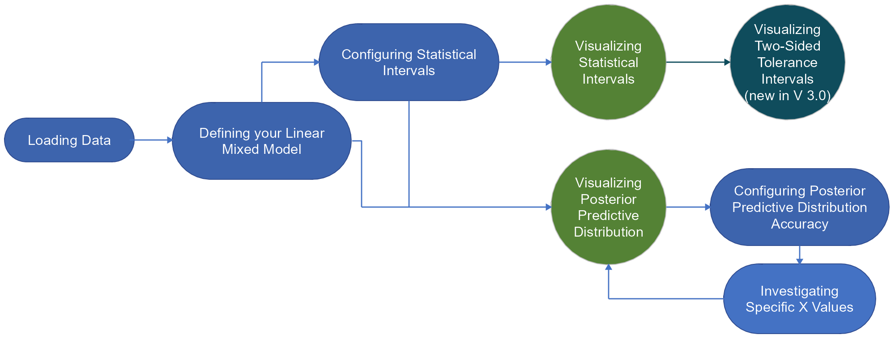{fig-align="center" width="100%"}

### Loading Data

-   Click the "Browse..." button next to "Choose CSV File" to select your data file (up to 30 MB)

-   Click the Load Data button.

-   Review your data in the "Data Preview" tab


-   Check for possible errors in the errors and warnings tab if Data Preview is not satisfactory. Consider the following questions:

    -   Are the columns appearing as expected in the data preview?

    -   Does it make sense that reported integer-only columns have only integer values (A column with decimals being shown as integer-only points to a parsing error!)

    -   Are there any NA and NAN values reported in the warnings and errors tab?

In the example, the tab lists the columns `Week` and `Iteration` as integer-only, which is correct for these columns.

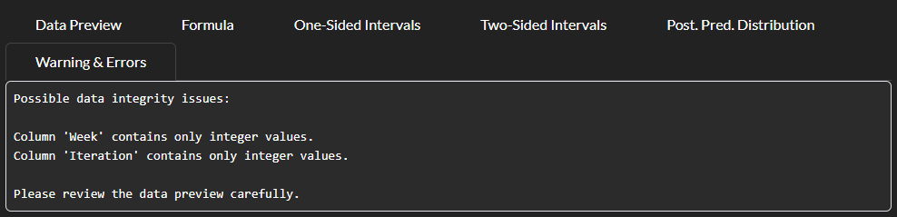

### Setting Up Your Linear Mixed Model

-   Check the "Log Normal" box if your data is log-normalized. All results are then back-transformed to the original scale.

-   Select one or more variables as "Fixed Effects" from the drop down menu (here `Intercept` and `TreatB`: the expected value for treatment B)

-   Optionally choose up to three "Covariates" and a "Covariate Value" for each. The value multiplies the covariate's coefficient column (here `Baseline` at a baseline value of 5)

-   Select one or more variables as "Variances" from the drop down menu (several variance columns are summed)

-   Set the "Multiplication Factor for Variances" if needed (default is 1)

-   Choose a "By Identifier" to group your data (or leave as default "Single Chain Dataset")

    -   *It is possible to choose more than one column as By identifier, which will result in these columns being concatenated. (E.g. Medicine1 Medicine2 and dosage1 dosage2 will be grouped as Medicine1_dosage1, Medicine2_dosage1, Medicine1_dosage2, Medicine2_dosage2)*

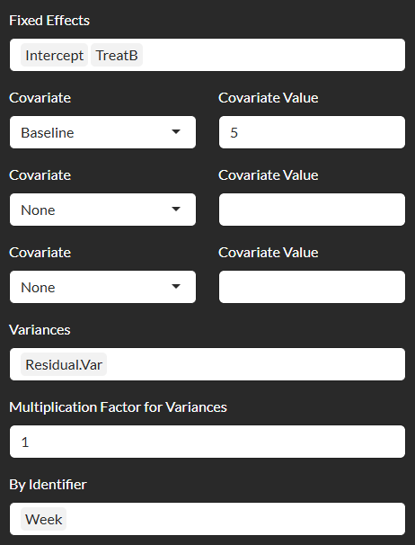{fig-align="center"}

-   Once your LMM (Linear Mixed Model) is defined you can review the generated formula in the "Formula" tab.

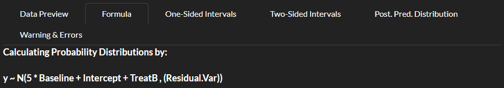

### Configuring Statistical Intervals

-   Set your desired "Tolerance Interval (%)" probability level and credibility level

-   Set your desired "Prediction Interval (%)"

-   Set your desired "Credible Interval (%)"

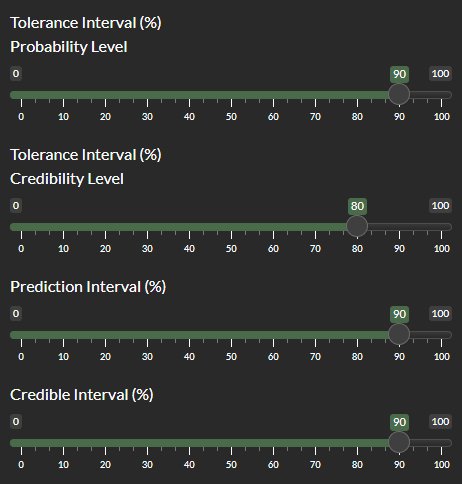{fig-align="center"}

The probability level *P* of the tolerance interval is the proportion of future observations it should cover; the credibility level *γ* determines how far into the tails of the MCMC draws the tolerance limits are placed (see section 5.1).

### Calculating and Visualizing Intervals

-   Click "Calculate Intervals" {height=34} to perform statistical calculations

-   Review the numerical results in the "One-Sided Intervals" tab table and examine the interval plots showing Credible Intervals (CI), Prediction Intervals (PI), and Tolerance Intervals (TI) for each unique value in the By column. (corresponding to different medicines, time points etc..)

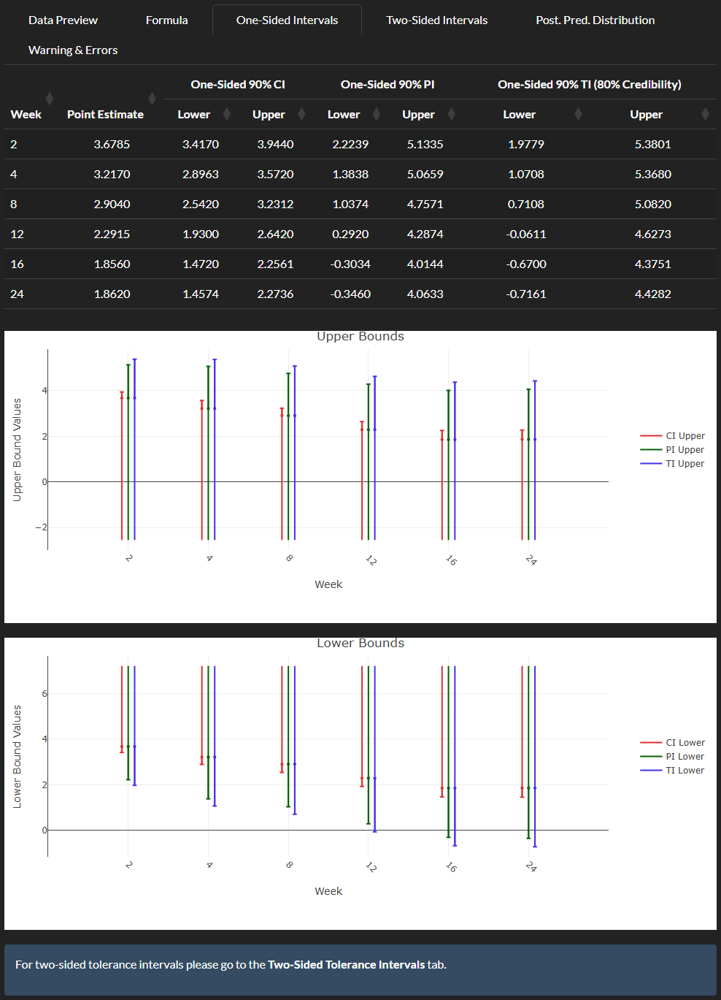

When an input is changed after the first calculation, the results update automatically about one second after your last change.

-   Click the Reducible Imprecision check-box to display the uncertainty margin between the prediction and tolerance intervals.

    -   Note that for Reducible Imprecision results to be meaningful, the Prediction Interval and the Tolerance Interval Prediction Level inputs must be the same. If these inputs are different, a popup warning will be generated.

For each side the reducible imprecision is the share of the distance between the tolerance bound and the median that is due to parameter uncertainty:

$$
\text{ReducibleUpper} = \frac{\text{TI}_{\text{upper}} - \text{PI}_{\text{upper}}}{\text{TI}_{\text{upper}} - \text{Median}},
\qquad
\text{ReducibleLower} = \frac{\text{TI}_{\text{lower}} - \text{PI}_{\text{lower}}}{\text{TI}_{\text{lower}} - \text{Median}}
$$

It is the part of the tolerance interval that a larger data set could remove. The application shows it in percent; the R function `bayesian_statistical_intervals()` returns it as a fraction.

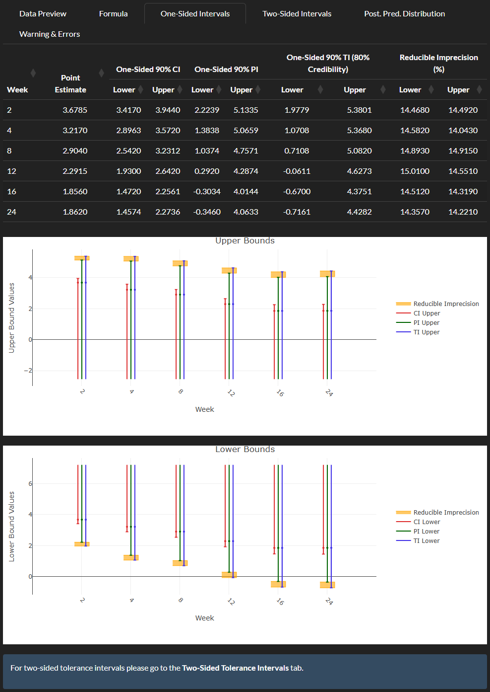

### Two-Sided Tolerance Intervals {#sec-two-sided-manual}

*New in version 3.0.* Click the "Two-Sided Tolerance Intervals" button. A two-sided tolerance interval has a lower and an upper limit, and the two limits are correlated across the MCMC draws, so the result is a two-dimensional region.

-   The first plot shows, for the groups you tick, the draws of the upper tolerance limit (horizontal axis) and the lower tolerance limit (vertical axis) together with a confidence ellipse.

-   The second plot, with the same axes, shows how one ordinary interval is derived from this region with the method of Krishnamoorthy and Mathew (2009): the orange line marks the points that are symmetric around the mean midpoint, and its optimal point (diamond) is chosen such that the chosen credibility level of the draws lies in the shaded upper-left rectangle, that is, such that this share of the draws has an upper limit below and a lower limit above the optimal point. Choose the group with the radio buttons.

-   The table at the bottom lists the resulting two-sided limits.

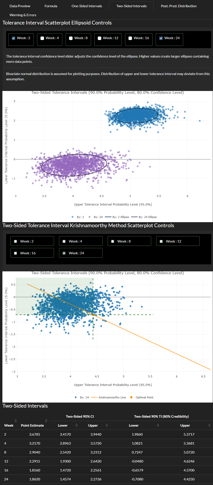

### Exploring Posterior Predictive Distributions

-   Click "Posterior Predictive Distribution" button {height=34} to view distribution plots

-   For each group in your data (specified by By column) there will be an input menu opened:

    -   Check the "Show" box to display the Posterior Predictive Distribution for this group

    -   Adjust the "Credibility Interval (%)" as needed

    -   Set the number of evaluation points (between 3 and 300) higher for smoother curves and slightly more accurate probabilities or lower for faster computation

    -   Enter x values of interest on the right, to see corresponding probabilities and credible intervals

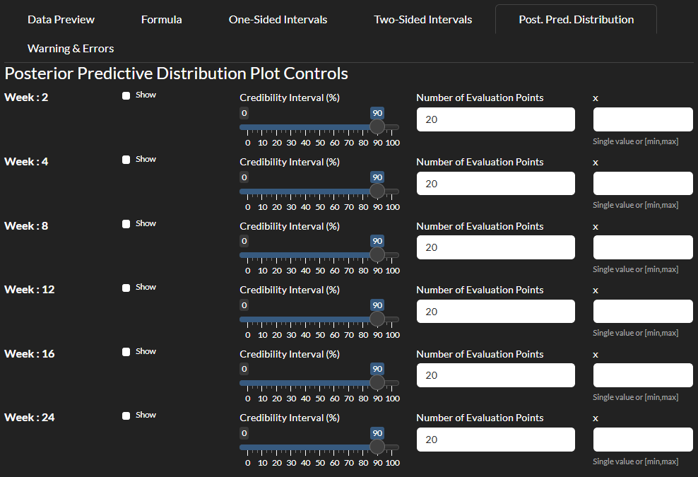

-   It is also possible to investigate an interval of x values instead of a single ended question. In order to investigate the probability of x falling within your interval of interest give your x minimum and x maximum values in this notation: [xmin,xmax]. Values outside the plotted range are reported as invalid.

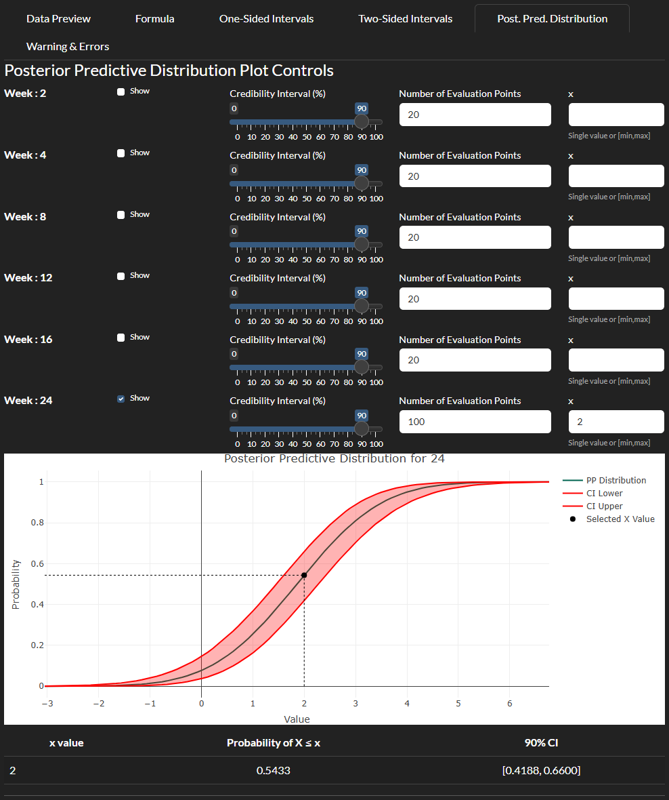

Keep in mind that while it is possible to display and edit multiple plots in parallel, it is not necessary to keep all open at once. Your adjustments regarding the by value inputs will be saved after initial render. Therefore you can safely close or re-open plots without much computational overhead.

### A Model with a Random Effect

The second example file contains a random patient effect and several fixed effects. The expected value of a patient on treatment B at the last visit is the sum of four fixed-effect columns, and the variance of a future observation is the sum of the random-effect variance and the residual variance. Select the columns accordingly:

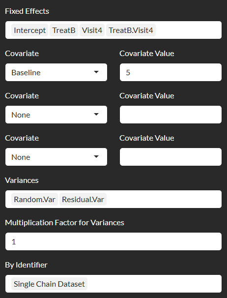{fig-align="center"}

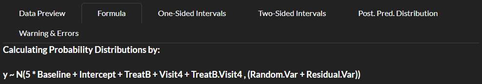

Without a By identifier there is a single group, and the intervals tab shows one set of intervals.

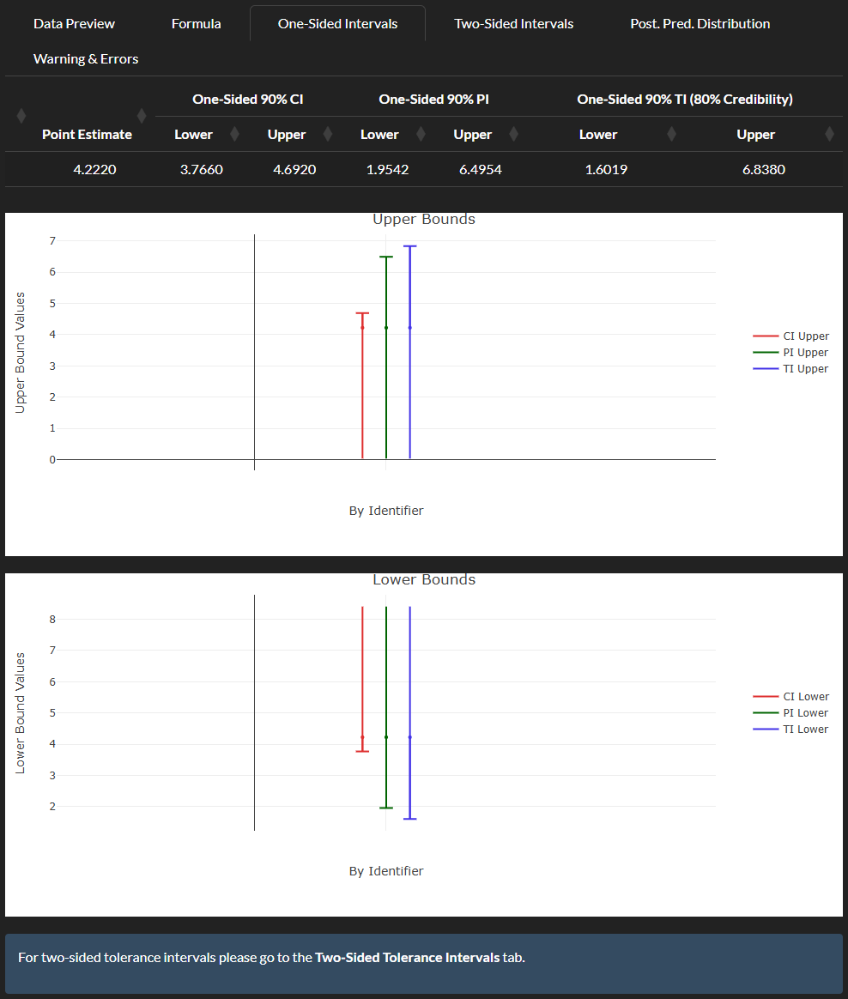

### Troubleshooting

-   Please make sure that your preview tab has all the columns you expect and that the values are correctly parsed.

-   Check the "Warning & Errors" tab if you encounter any issues. Errors of a calculation appear there, for example a column with missing values: "Fixed effect column 'Intercept' contains 1 missing or non-finite value(s) (first at row 5)". A negative variance in the draws is reported in the same tab.

-   Review data integrity warnings that may appear after loading your data

-   See working principle descriptions below to identify and review faulty module

-   If all else fails report the problem at <https://github.com/Sanofi-Public/BayesianSI.Calculator/issues>

## Library User Guide {#sec-library-guide}

All calculations of the application are available as functions of the package. The functions are grouped below in the same modules as in the working principle (section 4). All examples use the example files and run when this documentation is built.

```{r}
library(bayesintervals)
weekly   <- read.csv("example_data/example_by_week_mcmc.csv")
repeated <- read.csv("example_data/example_repeated_measures_mcmc.csv")
```

### Overview of the Functions

| Task | Functions |
|---|---|
| Read and prepare data | `load_n_inspect_data()`, `concatenate_by_columns()`, `parse_x_value_input()` |
| Distribution of every draw | `calculate_predicted_distributions()` |
| Intervals | `bayesian_statistical_intervals()` (main function), `calculate_ci()`, `calculate_tolerance_interval()`, `calculate_PI()`, `lognorm_adjuster()`, `perform_calculations()` (older variant) |
| Two-sided tolerance intervals | `calculate_gP_mean()`, `calculate_gamma_difference()`, `find_optimal_point()`, `add_krishnamoorthy_ti()` |
| Posterior predictive distribution | `create_cdf_dataframe()`, `create_all_cdf_dataframes()`, `create_CDF()`, `get_probability_table()` |
| Plots and tables | `plot_one_sided_intervals()`, `plot_intervals()`, `format_intervals_table()`, `quantile_scatterplot()`, `plot_krishnamoorthy()`, `plot_posterior_predictive()` |
| Application | `start_app_view()` |

: Functions by task {.striped}

### Reading and Preparing Data

`load_n_inspect_data(file_path = NULL, data = NULL, silent = FALSE)` reads a file (several formats and separators are tried) or takes a data frame, and checks it: types, missing values, columns with only integers. It returns the data and reports possible problems.

```{r}
checked <- load_n_inspect_data(data = weekly, silent = TRUE)
dim(checked)
```

`concatenate_by_columns(data, by_columns, new_column_name)` joins several grouping columns into one, as the application does for a multi-column By identifier. `parse_x_value_input(input_text)` interprets the x entry of the posterior predictive controls: a single value or a range `[min, max]`.

```{r}
groups <- data.frame(Drug = c("A", "B", "A", "B"), Dose = c(1, 1, 2, 2))
concatenate_by_columns(groups, by_columns = c("Drug", "Dose"))
str(parse_x_value_input("[0, 3]"))
```

### The Distribution of Every Draw

`calculate_predicted_distributions(data, fixed_effects, random_params, by, tolerance_level, multiplication_factor = 1, covariate_cols = NULL, covariate_values = NULL)` is the basis of everything else. For every draw it computes the mean (the sum of the fixed effects plus each covariate column times its value), the variance (the sum of the variance columns times the multiplication factor), and from these the median and the lower and upper quantile at the $(1-P)/2$ and $(1+P)/2$ levels, where *P* is `tolerance_level`. The columns are rounded to three decimals. The function stops with an error for non-numeric columns, missing values, or negative variances.

```{r}
pd <- calculate_predicted_distributions(
  data = weekly,
  fixed_effects = c("Intercept", "TreatB"),
  random_params = "Residual.Var",
  by = "Week",
  tolerance_level = 90,
  covariate_cols = "Baseline",
  covariate_values = 5
)
head(pd)
```

### Credible, Tolerance and Prediction Intervals

Three functions work on this table, one per interval type. `calculate_ci()` uses the per-draw median, `calculate_tolerance_interval()` the lower and upper quantile columns, and `calculate_PI()` the mean and variance columns.

```{r}
ci <- calculate_ci(pd, ColToAggregate = "median", PercentForCI = 90, ByColumn = "By")
ti <- calculate_tolerance_interval(pd, LowerColToAggregate = "lower_quantile",
                                   UpperColToAggregate = "upper_quantile",
                                   ConfidenceLevel = 80, ByColumn = "By")
pi <- calculate_PI(pd, percent_for_pi = 90)
knitr::kable(merge(merge(ci, ti, by = "By"), pi, by = "By"), digits = 3)
```

`bayesian_statistical_intervals()` performs the whole chain in one call: the distributions of the draws, the three intervals, the reducible imprecision, the optional log-normal back-transformation and the optional Krishnamoorthy limits. It returns a list with `data` (the results), `summary` (a sentence describing the settings) and `pred_dist` (the table from the previous step).

```{r}
result <- bayesian_statistical_intervals(
  data = weekly,
  fixed_effects = c("Intercept", "TreatB"),
  random_params = "Residual.Var",
  by = "Week",
  tolerance_interval_level = 90,
  credibility_of_tolerance_interval = 80,
  credible_interval_level = 90,
  prediction_interval_level = 90,
  covariate_cols = "Baseline",
  covariate_values = 5
)
knitr::kable(result$data, digits = 3)
result$summary
```

The numbers equal those of the application for the same settings. `perform_calculations()` is an older variant of this function with fewer options (no covariates, no Krishnamoorthy limits); it reports the reducible imprecision in percent. With `log_normal = TRUE` the results are transformed back with the exponential function and the reducible imprecision is recomputed on the original scale; `lognorm_adjuster()` does this step on a results table.

```{r}
log_result <- bayesian_statistical_intervals(
  data = weekly, fixed_effects = c("Intercept", "TreatB"), random_params = "Residual.Var",
  by = "Week", tolerance_interval_level = 90, covariate_cols = "Baseline",
  covariate_values = 5, log_normal = TRUE)
knitr::kable(head(log_result$data[, c("By", "Median", "CI_Lower", "CI_Upper", "PI_Lower", "PI_Upper")], 3), digits = 2)
```

### Two-Sided Tolerance Intervals (Krishnamoorthy Method)

The construction is available step by step. `calculate_gP_mean(scatter_data, P)` returns, per group, the mean of the midpoints of the lower and upper quantile. `find_optimal_point(scatter_data, gP_mean_vector, gamma_actual)` searches along the line $g_2 = 2\bar g_P - g_1$ for the point at which the share of draws whose own interval lies inside the candidate interval equals `gamma_actual` (it uses `calculate_gamma_difference()` for the share). `add_krishnamoorthy_ti()` adds the resulting limits to a results table (columns `K_TI_Lower` and `K_TI_Upper`).

```{r}
gp  <- calculate_gP_mean(pd, P = 90)
opt <- find_optimal_point(pd, gP_mean_vector = gp, gamma_actual = 80)
opt[["24"]]
knitr::kable(add_krishnamoorthy_ti(result$data, opt)[, c("By", "TI_Lower", "TI_Upper", "K_TI_Lower", "K_TI_Upper")], digits = 3)
```

The same limits are obtained directly with `use_krishnamoorthy = TRUE` in `bayesian_statistical_intervals()`. Two plots show the construction:

```{r}
quantile_scatterplot(pred_dist = pd, selected_by_values = c("2", "24"),
                     tolerance_level = 90, ellipse_confidence = 90)
```

```{r}
plot_krishnamoorthy(data = pd, by_value = "24", optimal_point = opt[["24"]],
                    tolerance_level = 90, confidence_level = 80)
```

### Posterior Predictive Distribution

`create_cdf_dataframe(pred_dist, by_value, n_points, ci_level)` evaluates the distribution function of every draw on a grid of x values and summarizes it: the curve is the median over the draws and the band the quantiles at the chosen credibility. `create_all_cdf_dataframes()` does this for all groups and `create_CDF()` combines it with the preceding step, starting from the raw draws.

```{r}
cdf_all <- create_CDF(
  data = weekly, fixed_effects = c("Intercept", "TreatB"), random_params = "Residual.Var",
  by = "Week", tolerance_level = 90, n_points = 100, ci_level = 90,
  covariate_cols = "Baseline", covariate_values = 5)
names(cdf_all)
head(cdf_all[["24"]])
```

`plot_posterior_predictive(cdf_data, x_value)` draws the curve and, for a given x, marks the probability. `get_probability_table()` returns the probability that a future observation is at most *x* (or within a range) and its credible interval. It is calculated from the *average* of the per-draw distribution functions, whereas the application reads its table from the plotted curve, which is the *median* over the draws. The two agree to about two decimals for a single value; for a range they can differ by about 0.01 (for `[0, 3]` in Week 24 the application shows 0.732 and the function 0.723). The credible intervals are identical.

```{r}
plot_posterior_predictive(cdf_all[["24"]], x_value = "2")
```

```{r}
get_probability_table(pred_dist = pd, by_value = "24", x_value = "[0, 3]", ci_percent = 90)
```

### Plots and Tables of the Intervals

`plot_one_sided_intervals(data, show_reducible)` draws the upper and the lower bounds, as in the application. `plot_intervals(result)` shows the intervals of all groups in one plot, and `format_intervals_table(result)` formats the results as an interactive table. All of them return interactive objects that can be embedded in reports.

```{r}
plots <- plot_one_sided_intervals(result$data, show_reducible = TRUE)
plots$upper
```

```{r}
plots$lower
```

### A Model with a Random Effect

The variance of a future observation is the sum of the two variance columns.

```{r}
bayesian_statistical_intervals(
  data = repeated,
  fixed_effects = c("Intercept", "TreatB", "Visit4", "TreatB.Visit4"),
  random_params = c("Random.Var", "Residual.Var"),
  by = "Single Chain Dataset",
  tolerance_interval_level = 90, credibility_of_tolerance_interval = 80,
  credible_interval_level = 90, prediction_interval_level = 90,
  covariate_cols = "Baseline", covariate_values = 5
)$data |> knitr::kable(digits = 3)
```

## Working Principle

BSI uses a sidebar-main panel interface with tabbed navigation. The application maintains state through reactive variables that store uploaded data, calculation results, and error messages.

Statistical calculations are performed by specialized functions handling Bayesian interval computations and data validation. The app employs reactive programming to automatically update derived values when dependencies change, ensuring visualizations remain synchronized with the underlying statistical model.

Error handling is integrated throughout to maintain stability and provide meaningful feedback to users.

The application is deliberately self-contained in one file (`inst/shiny/app.R` of the package), so it keeps its own copies of the statistical functions of the package. A test in the package checks that the copies give the same results as the package functions. The code samples below are taken from this file; console output used for debugging has been left out.

### Index of code sections

1.  **SETUP** *(rows 1-139)*

2.  **USER INTERFACE "front end"** *(rows 140-506)*

3.  **SERVER LOGIC "back end"** *(rows 507-4185)*

    3.1 Reactive Values

    3.2 Functions

    3.3 Reactive Expressions

    3.4 Observers

    3.5 Event Handlers

    3.6 Output Renderers

### Flowchart of Modules

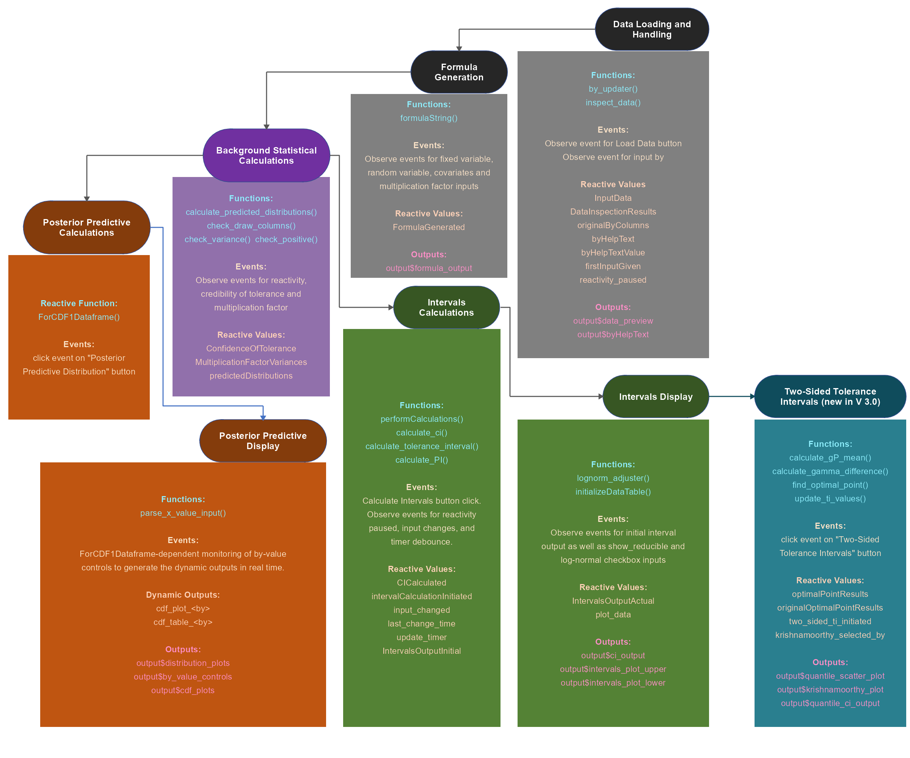{fig-align="center" width="100%"}

::: {.callout-note collapse="true"}
## What is new in the flowchart (version 3.0)

-   The module **Two-Sided Tolerance Intervals** was added (section 4.8).

-   The unused reactive value `dist_data` was removed from the module Posterior Predictive Calculations; the outputs read the reactive expression `ForCDF1Dataframe()` directly.

-   The interval plot is split into the two outputs `output$intervals_plot_upper` and `output$intervals_plot_lower`.

-   `calculate_PI()` was changed to the posterior predictive definition of the prediction interval (section 4.6).

-   The calculations check their inputs with `check_draw_columns()`, `check_variance()` and `check_positive()`.
:::


### Data Loading and Handling {#data-loading-and-handling}

This feature is responsible for importing data from various file formats, validating it, and preparing it for analysis. It's the entry point for user data and sets up the foundation for all subsequent calculations.

::: {.callout-note collapse="true"}
## Modular Elements

**Functions:**

-   \[by_updater\]: Manages the "By" identifier column selection, which determines how data is grouped for analysis. It handles single selections, multiple selections (by concatenating columns), and the special "Single Chain Dataset" case.

-   \[inspect_data\]: Checks the types, the missing values and the integer-only columns of the uploaded data and stores the findings.

**Event Handlers:**

-   \[observeEvent(input\$load_data, {...})\]: Triggered when the user clicks the "Load Data" button. It reads the file using multiple parsing methods for different formats:

    -   data.table's fread (fastest for large CSV files)

    -   readr's read_csv (handles CSV with various encodings)

    -   base R's read.csv (standard CSV parser)

    -   read.table with tab separator (for TSV files)

    -   read.table with various separators (comma, semicolon, pipe, slash) for flexibility

-   \[observeEvent(input\$by, {...})\]: Manages the selection of grouping variables. It handles special cases like preventing simultaneous selection of "Single Chain Dataset" with other columns, creates merged columns when multiple selections are made, and updates help text accordingly.

**Reactive Values:**

-   \[InputData\], \[DataInspectionResults\]: The uploaded data and the results of the data check.

-   \[originalByColumns \<- reactiveVal(NULL)\]: Remembers the original columns selected for the "By" identifier when multiple columns are merged.

-   \[byHelpText \<- reactiveVal("You can select multiple columns. They will be concatenated if more than one is selected.")\]: Contains dynamic help text for the "By" selection.

**Outputs:** \[output\$data_preview\], \[output\$byHelpText\]

**Library counterpart:** `load_n_inspect_data()`, `concatenate_by_columns()`
:::

::: {.callout-tip collapse="true"}
## Chain of Events

1- User uploads a file and clicks "Load Data" triggering \[observeEvent(input\$load_data, {...})\]

2- The app attempts to read the file using multiple methods in this order:

-   fread (fastest for standard CSV)

-   read_csv (handles various encodings)

-   read.csv (standard CSV parser)

-   read.table with tab separator (for TSV)

-   read.table with various separators (comma, semicolon, pipe, slash)

3- If successful, the data is stored in \[InputData(data)\]

4- Data is inspected via \[inspect_data(data)\] and results stored in \[DataInspectionResults(inspection_results)\]

5- UI elements are updated with the column names: the selectors for fixed effects, covariates, variances and the By identifier (default "Single Chain Dataset")

6- The app switches to the "Data Preview" tab with \[updateTabsetPanel(session, "main_tabs", selected = "Data Preview")\]

7- Notifications are shown about successful loading or warnings

8- When the user selects "By" identifier columns, \[observeEvent(input\$by, {...})\] is triggered:

-   First, reactivity is paused with \[reactivity_paused(TRUE)\] and the current selection is stored.

-   The app handles special cases: showing errors for invalid combinations, setting defaults for empty selections, and storing original columns for multiple selections.

-   For multiple columns, a merged "Merged_By_Columns" column (values joined with an underscore) is created, added to the dataset, and the UI is updated accordingly.

-   For "Single Chain Dataset" selection, a SingleChain column with value 1 is added if needed.

-   Finally, reactivity is resumed with \[reactivity_paused(FALSE)\] and help text is rendered through \[output\$byHelpText\].

This module establishes the data foundation that all other modules will build upon, ensuring data is properly loaded, validated, and prepared for statistical analysis regardless of the input file format.
:::

### Formula Generation {#formula-generation}

This feature is responsible for creating and displaying the statistical formula based on user selections for fixed effects, covariates and random variables. It provides visual feedback to users about how their selections will be used in calculations.

::: {.callout-note collapse="true"}
## Modular Elements

**Functions:**

-   **\[formulaString\]:** A reactive function that generates a formatted HTML string representing the statistical formula based on user inputs for fixed effects, covariates, random variables, and multiplication factor.

**Event Handlers:**

-   \[observeEvent(c(input\$fixed_var, input\$random_var, input\$multiplication_factor, input\$covariate_var), {...})\]: Triggered when any of the key formula components change, updates the FormulaGenerated flag.

**Reactive Values:**

-   \[FormulaGenerated \<- reactiveVal(FALSE)\]: Tracks whether a formula has been generated based on user inputs.

**Outputs:** \[output\$formula_output\]
:::

::: {.callout-tip collapse="true"}
## Chain of Events

1- User selects fixed effects variables from the "Fixed Effects" dropdown (\[input\$fixed_var\]), covariates, "Variances" dropdown (\[input\$random_var\]) and multiplication factor for variances (\[input\$multiplication_factor\])

2- The \[observeEvent\] detects these changes and triggers the \[formulaString\] reactive

3- The \[formulaString\] reactive: Creates an HTML representation of the formula in the form: y \~ N(covariate terms + fixed_effects, multiplication_factor \* (random_effects))

4- If this is the first formula generation, \[FormulaGenerated(TRUE)\] is set

5- The formula is rendered to the UI through \[output\$formula_output \<- renderUI({...})\] which displays the HTML generated by \[formulaString()\]

This module provides immediate visual feedback on how the statistical model will be constructed.
:::

### Background Statistical Calculations {#background-statistical-calculations}

This feature handles the core statistical parameters and calculations that underpin the statistical model. It manages tolerance levels and multiplication factors that affect how variances are treated in the statistical calculations.

::: {.callout-note collapse="true"}
## Modular Elements

**Functions:**

-   **\[calculate_predicted_distributions\]**: The primary function that calculates statistical distribution parameters for the entire dataset. It processes fixed effects, covariates and random parameters to compute mean, median, quantiles, and variance for all rows, grouped by the "By" variable. This function uses vectorized operations for efficient processing of large datasets.

-   \[check_draw_columns\], \[check_variance\], \[check_positive\]: Input checks. Columns must be numeric and complete, the summed variances must not be negative and the multiplication factor must be a positive number.

**Event Handlers:**

-   \[observe({req(!reactivity_paused()); ConfidenceOfTolerance(input\$confidence_of_tolerance)})\]: Updates the credibility of tolerance reactive value when the user changes the credibility level slider.

-   \[observe({req(input\$multiplication_factor); req(!reactivity_paused()); ...})\]: Monitors changes to the multiplication factor input, validates that it's a numeric value, and updates the MultiplicationFactorVariances reactive value.

**Reactive Values:**

-   \[ConfidenceOfTolerance \<- reactiveVal(95)\]: Stores the credibility level for tolerance intervals.

-   \[MultiplicationFactorVariances \<- reactiveVal(1)\]: Stores the multiplication factor applied to variance components in the statistical model, initialized to 1.

-   \[predictedDistributions\]: The result table of \[calculate_predicted_distributions\].

**Library counterpart:** `calculate_predicted_distributions()`
:::

::: {.callout-important collapse="true"}
## Code Sample: calculate_predicted_distributions

```r
calculate_predicted_distributions <- function() {
  req(InputData(), input$fixed_var, input$random_var, input$by, input$tolerance_level)

  FixedEffects <- input$fixed_var
  RandomParams <- input$random_var

  # Check if "Single Chain Dataset" is selected
  is_single_chain <- identical(input$by, "Single Chain Dataset")
  By <- if(is_single_chain) "SingleChain" else input$by
  ToleranceLevel <- input$tolerance_level

  # If "Single Chain Dataset" is selected, create a SingleChain column if it doesn't exist
  if(By == "SingleChain" && !"SingleChain" %in% names(InputData())) {
    temp_data <- InputData()
    temp_data$SingleChain <- 1
    InputData(temp_data)
  }

  # Create a copy of the data to avoid modifying the original
  dt <- copy(as.data.table(InputData()))

  # Draws must be numeric and complete; NA or infinite draws would otherwise be
  # silently treated as zero. Errors are shown to the user through ErrorMessage.
  check_positive(MultiplicationFactorVariances(), "Multiplication factor")
  check_draw_columns(dt, FixedEffects, "Fixed effect")
  check_draw_columns(dt, RandomParams, "Variance component")
  for (k in 1:3) {
    cov_col_k <- input[[paste0("covariate_", k)]]
    if (!is.null(cov_col_k) && cov_col_k != "None" && cov_col_k %in% names(dt)) {
      check_draw_columns(dt, cov_col_k, "Covariate")
    }
  }
  if (anyNA(dt[[By]])) stop(sprintf("By column '%s' contains missing values", By), call. = FALSE)

  # Print column types for debugging
  for(col in c(FixedEffects, RandomParams)) {
  }

  # Initialize mean vector with zeros
  mean_vector <- rep(0, nrow(dt))

  # First, add covariate effects to mean
  for(i in 1:3) {
    covariate_col <- input[[paste0("covariate_", i)]]
    covariate_val <- input[[paste0("covariate_value_", i)]]

    # Only process if a covariate column is selected
    if(!is.null(covariate_col) && covariate_col != "None" && covariate_col %in% names(dt)) {
      # Get the column values
      col_vector <- as.numeric(dt[[covariate_col]])

      # Use covariate value (defaults to 1 if NULL or NA)
      multiplier <- if(is.null(covariate_val) || is.na(covariate_val)) 1 else covariate_val

      # Add covariate effect to mean
      mean_vector <- mean_vector + (col_vector * multiplier)

      print(paste("Sample values after adding covariate", i, ":",
                  paste(head(mean_vector, 3), collapse=", ")))
    }
  }

  # Then add fixed effects
  if(length(FixedEffects) > 0) {
    fixed_matrix <- matrix(
      as.numeric(unlist(dt[, ..FixedEffects])),
      nrow = nrow(dt),
      ncol = length(FixedEffects)
    )

    # Add fixed effects to mean
    mean_vector <- mean_vector + rowSums(fixed_matrix, na.rm = TRUE)

    print(paste("Sample values after adding fixed effects:",
                paste(head(mean_vector, 3), collapse=", ")))
  }

  # Calculate variance
  if(length(RandomParams) > 0) {
    random_matrix <- matrix(
      as.numeric(unlist(dt[, ..RandomParams])),
      nrow = nrow(dt),
      ncol = length(RandomParams)
    )

    # Calculate total variance
    variance_vector <- rowSums(random_matrix, na.rm = TRUE) * MultiplicationFactorVariances()
    check_variance(variance_vector)
  } else {
    variance_vector <- rep(0, nrow(dt))
  }

  # Print matrix types for debugging

  # Calculate tolerance parameters
  toleranceaplha <- ToleranceLevel / 100
  toleranceslice <- (1 - toleranceaplha) / 2

  # Calculate quantiles using the mean and variance
  lower_quantiles <- qnorm(toleranceslice, mean = mean_vector, sd = sqrt(pmax(variance_vector, 1e-10)))
  upper_quantiles <- qnorm(toleranceaplha + toleranceslice, mean = mean_vector, sd = sqrt(pmax(variance_vector, 1e-10)))
  medians <- qnorm(0.5, mean = mean_vector, sd = sqrt(pmax(variance_vector, 1e-10)))

  # Create result data.table
  PredictedDistributions_dt <- data.table(
    By = dt[[By]],
    mean = mean_vector,
    median = medians,
    lower_quantile = lower_quantiles,
    upper_quantile = upper_quantiles,
    variance = variance_vector
  )

  # Round to 3 decimals. The inputs are validated to be finite, so every value is
  # a finite number and the columns stay numeric.
  for (col in c("mean", "median", "lower_quantile", "upper_quantile", "variance")) {
    if (any(!is.finite(PredictedDistributions_dt[[col]]))) {
      stop(sprintf("Non-finite values occurred in '%s'; check the scale of the inputs", col),
           call. = FALSE)
    }
    PredictedDistributions_dt[[col]] <- round(PredictedDistributions_dt[[col]], 3)
  }

  # Sort by the "By" column
  setorder(PredictedDistributions_dt, By)

  return(as.data.frame(PredictedDistributions_dt))
}
```
:::

::: {.callout-tip collapse="true"}
## Chain of Events

1- The function collects the user's selections: fixed effects, covariates with their values, variances, the By identifier and the tolerance level.

2- The inputs are checked: the columns must be numeric without missing or infinite values, the By column must not contain missing values, and the multiplication factor must be positive.

3- The mean of every draw is the sum of the covariate effects (column times covariate value) and the fixed effects.

4- The variance of every draw is the sum of the variance columns times the multiplication factor; a negative total variance stops the calculation with an error.

5- From the mean and the variance the median and the lower and upper quantile are calculated at the $(1-P)/2$ and $(1+P)/2$ levels of a normal distribution, where *P* is the tolerance level.

6- The columns are rounded to three decimals, the table is sorted by the By value, and it is returned and stored in \[predictedDistributions\].

This module forms the statistical core of the application, providing the foundation for all interval calculations and visualizations. It implements efficient vectorized operations to handle large datasets and ensures numerical stability throughout the calculations.

**Implementation Details:**

-   Efficient Data Processing:

    -   Uses data.table for fast data manipulation

    -   Creates matrices for vectorized calculations

    -   Calculates parameters in bulk rather than row-by-row

-   Numerical Stability:

    -   Uses pmax(variance, 1e-10) to prevent a zero standard deviation

    -   Checks for missing, infinite and negative values before calculating

    -   Rounds results for better display
:::

### Interval Calculations {#interval-calculations}

This feature is responsible for calculating various statistical intervals (Credible, Prediction, and Tolerance intervals) based on the user's selections and the statistical model. It performs the core statistical computations that generate the app's primary outputs.

::: {.callout-note collapse="true"}
## Modular Components

**Functions:**

-   \[calculate_ci\]: Calculates credible intervals for the specified data, aggregating by the selected "By" column and computing quantiles based on the user-specified credibility level.

-   \[calculate_tolerance_interval\]: Computes tolerance intervals using the lower and upper quantiles of the draws, incorporating the user-specified credibility level.

-   \[calculate_PI\]: Determines prediction intervals as quantiles of the posterior predictive distribution, the average of the distribution functions of all draws (see the code sample).

-   \[performCalculations\]: Orchestrates the entire calculation process, calling the individual interval calculation functions and merging their results.

**Event Handlers:**

-   \[observeEvent(input\$calculate_ci, {...})\]: Triggered when the user clicks the "Calculate Intervals" button, initiates the interval calculation process.

-   \[observe({req(!reactivity_paused()); input\$fixed_var; input\$random_var; ...})\]: Monitors changes to key inputs that affect calculations and triggers recalculation when needed.

-   \[observe({req(!reactivity_paused()); update_timer(); ...})\]: Implements a debounce mechanism to prevent excessive recalculations when multiple inputs change rapidly.

**Reactive Values:**

-   \[CICalculated \<- reactiveVal(FALSE)\]: Tracks whether intervals have been calculated.

-   \[IntervalsOutputInitial \<- reactiveVal(NULL)\]: Stores the raw interval calculation results before any transformations.

-   \[IntervalsOutputActual \<- reactiveVal(NULL)\]: Stores the interval values after any necessary log-normal transformations, ready for display.

-   \[intervalCalculationInitiated \<- reactiveVal(FALSE)\]: Indicates whether the interval calculation process has been started.

-   \[input_changed \<- reactiveVal(FALSE)\]: Tracks whether inputs have changed since the last calculation.

-   \[last_change_time \<- reactiveVal(Sys.time())\]: Records when inputs were last changed.

-   \[update_timer \<- reactiveTimer(1000)\]: A timer that triggers updates at regular intervals.

**Library counterpart:** `bayesian_statistical_intervals()`, `calculate_ci()`, `calculate_tolerance_interval()`, `calculate_PI()`
:::

::: {.callout-important collapse="true"}
## Code Sample: performCalculations()

```r
performCalculations <- function(switch_tab = FALSE) {
  tryCatch({
    # Calculate predictedDistributions
    incProgress(0.2)
    pred_dist <- calculate_predicted_distributions()
    predictedDistributions(pred_dist)

    # Calculate CI
    incProgress(0.2)
    ci_result <- calculate_ci(pred_dist, "median", input$percent_for_ci, "By")

    # Calculate TI
    incProgress(0.2)
    ti_result <- calculate_tolerance_interval(
      pred_dist,
      "lower_quantile",
      "upper_quantile",
      input$confidence_of_tolerance,
      "By"
    )

    # Calculate PI
    incProgress(0.2)
    pi_result <- calculate_PI(
      data = pred_dist,
      percent_for_pi = input$percent_for_pi
    )

    # check column names in PI result for debugging

    # Merge results
    incProgress(0.2)
    combined_result <- merge(merge(ci_result, ti_result, by = "By"), pi_result, by = "By")

    # Failsafe check
    if (any(table(combined_result$By) > 1)) {
      check_consistency <- combined_result %>%
        group_by(By) %>%
        summarise(across(everything(), function(x) length(unique(head(x, 5))) == 1)) %>%
        ungroup()

      if (!all(sapply(check_consistency[,-1], all))) {
        warning("Inconsistent values detected for some 'By' groups. Using first row for each group.")
      }

      # Ensure only one row per unique "By" value
      combined_result <- combined_result %>%
        group_by(By) %>%
        summarise(across(everything(), first)) %>%
        ungroup()
    }

    # Add reducible imprecision as percentages (with a notification if it is not
    # defined for a group). With log-normal data it is recalculated afterwards.
    combined_result <- withCallingHandlers(
      add_reducible_imprecision(combined_result, warn = !isTRUE(input$log_normal), percent = TRUE),
      warning = function(w) {
        showNotification(conditionMessage(w), type = "warning")
        invokeRestart("muffleWarning")
      })

    # Store the combined result
    IntervalsOutputInitial(combined_result)
    CICalculated(TRUE)

    # Trigger lognorm_adjuster
    lognorm_adjuster()

    # Only switch to the Intervals tab if switch_tab is TRUE
    if (switch_tab) {
      updateTabsetPanel(session, "main_tabs", selected = "One-Sided Intervals")
    }

  }, error = function(e) {
    ErrorMessage(paste("Error in calculating intervals:", e$message))
  })

  if (!is.null(IntervalsOutputActual())) {
    # Calculate plots once and cache them
    interval_plots_cache(render_intervals_plot_one_sided(IntervalsOutputActual(), input))
  }
}
```
:::

::: {.callout-important collapse="true"}
## Code Sample: calculate_ci()

```r
calculate_ci <- function(data, ColToAggregate, PercentForCI, ByColumn) {
  # Convert to data.table if not already
  if (!is.data.table(data)) {
    dt <- as.data.table(data)
  } else {
    dt <- data
  }

  if (!ColToAggregate %in% names(dt) || !ByColumn %in% names(dt)) {
    stop(paste("Column", ColToAggregate, "or", ByColumn, "not found in the dataframe"))
  }

  # Calculate alpha and slice once
  alpha <- 1 - PercentForCI/100
  slice <- alpha / 2

  # Use data.table syntax for faster grouping and calculation
  results <- dt[, .(
    N = .N,
    CI_Lower = quantile(get(ColToAggregate), slice),
    CI_Upper = quantile(get(ColToAggregate), 1 - slice),
    Median = median(get(ColToAggregate))
  ), by = ByColumn]

  return(as.data.frame(results))
}
```
:::

::: {.callout-important collapse="true"}
## Code Sample: calculate_PI()

In version 3.0 the prediction interval is calculated from the posterior predictive distribution of the paper: the average over the draws of the normal distribution functions, $\tilde p(x) = \frac{1}{M}\sum_m \Phi((x-\mu_m)/\sigma_m)$. Its $(1-P)/2$ and $(1+P)/2$ quantiles are found numerically. The smallest and the largest per-draw quantile form a bracket that is guaranteed to contain the quantile of the average; inside this bracket Newton steps are used where they stay inside, and bisection otherwise. The tolerance `Eta` is relative to the standard deviation of the predictive distribution.

```r
calculate_PI <- function(data, percent_for_pi, Eta = 1e-8) {
  # Check inputs
  if (!is.data.frame(data) || !is.numeric(percent_for_pi) || length(percent_for_pi) != 1 ||
      !is.finite(percent_for_pi) || percent_for_pi <= 0 || percent_for_pi >= 100) {
    stop("Invalid input parameters")
  }
  if (!all(c("By", "mean", "variance") %in% names(data))) {
    stop("'data' must contain the columns By, mean and variance")
  }
  if (!is.numeric(Eta) || length(Eta) != 1 || !is.finite(Eta) || Eta <= 0) {
    stop("'Eta' must be a single positive number")
  }

  # The two probabilities at which the limits are required
  slice <- (1 - percent_for_pi / 100) / 2
  probabilities <- c(slice, 1 - slice)

  # Bisection on  mean_m(Phi((x - mu_m) / sigma_m)) - p
  find_PI_limits <- function(means, variances) {
    sds <- sqrt(pmax(variances, 1e-12))
    vapply(probabilities, function(p) {
      per_draw <- stats::qnorm(p, mean = means, sd = sds)
      lower <- min(per_draw)
      upper <- max(per_draw)
      initial_width <- upper - lower
      # Precision is relative to the spread of the predictive distribution itself
      # (average variance plus variance of the means), not to the size of the bracket
      total_sd <- sqrt(mean(sds^2) + if (length(means) > 1) stats::var(means) else 0)
      tolerance <- Eta * total_sd
      if (initial_width == 0) {
        return(lower)
      }
      # Start from the quantile of the single averaged normal, which is close
      x <- stats::qnorm(p, mean = mean(means), sd = sqrt(mean(sds^2)))
      if (!is.finite(x) || x <= lower || x >= upper) {
        x <- (lower + upper) / 2
      }
      for (iteration in seq_len(200)) {
        # value of (average of the per-draw CDFs) - p, and its bracket update
        value <- mean(stats::pnorm(x, mean = means, sd = sds)) - p
        if (value < 0) {
          lower <- x
        } else {
          upper <- x
        }
        if (upper - lower <= tolerance) {
          break
        }
        # Newton step (the derivative is the average of the per-draw densities);
        # whenever it leaves the bracket, bisect instead, so convergence is guaranteed
        slope <- mean(stats::dnorm(x, mean = means, sd = sds))
        step <- x - value / slope
        if (!is.finite(step) || step <= lower || step >= upper) {
          step <- (lower + upper) / 2
        }
        if (abs(step - x) <= tolerance) {
          x <- step
          break
        }
        x <- step
      }
      x
    }, numeric(1))
  }

  groups <- unique(data$By)
  limits <- lapply(groups, function(group) {
    rows <- which(data$By == group)
    means <- as.numeric(data$mean[rows])
    variances <- as.numeric(data$variance[rows])
    if (anyNA(means) || anyNA(variances)) {
      stop("'mean' and 'variance' must not contain missing values")
    }
    find_PI_limits(means, variances)
  })

  data.frame(
    By = groups,
    PI_Lower = vapply(limits, function(x) x[1], numeric(1)),
    PI_Upper = vapply(limits, function(x) x[2], numeric(1))
  )
}
```
:::

::: {.callout-important collapse="true"}
## Code Sample: calculate_tolerance_interval()

```r
calculate_tolerance_interval <- function(data, LowerColToAggregate, UpperColToAggregate, ConfidenceLevel, ByColumn) {
  # Convert to data.table if not already
  if (!is.data.table(data)) {
    dt <- as.data.table(data)
  } else {
    dt <- data
  }

  if (!LowerColToAggregate %in% names(dt) || !UpperColToAggregate %in% names(dt) || !ByColumn %in% names(dt)) {
    stop(paste("One or more required columns not found in the dataframe"))
  }

  # Calculate confidence parameters once
  confidence_alpha <- 1 - ConfidenceLevel/100
  confidence_slice <- confidence_alpha / 2

  # Use data.table syntax for faster grouping and calculation
  results <- dt[, .(
    N = .N,
    Lower_Lower = quantile(get(LowerColToAggregate), confidence_slice),
    Lower_Upper = quantile(get(LowerColToAggregate), 1 - confidence_slice),
    Upper_Lower = quantile(get(UpperColToAggregate), confidence_slice),
    Upper_Upper = quantile(get(UpperColToAggregate), 1 - confidence_slice)
  ), by = ByColumn]

  # Add TI columns
  results[, `:=`(
    TI_Lower = Lower_Lower,
    TI_Upper = Upper_Upper
  )]

  # Select only needed columns
  results <- results[, .(By = get(ByColumn), TI_Lower, TI_Upper)]

  return(as.data.frame(results))
}
```
:::

::: {.callout-note collapse="true"}
## Chain Of Events

1- User clicks the "Calculate Intervals" button, triggering \[observeEvent(input\$calculate_ci, {...})\]

2- The event handler sets \[intervalCalculationInitiated(TRUE)\] and calls \[performCalculations()\] within a progress indicator

3- The \[performCalculations\] function:

-   Calculates predicted distributions using \[calculate_predicted_distributions()\]

-   Stores the results in \[predictedDistributions\]

-   Calculates credible intervals (CI) using \[calculate_ci\]

-   Calculates tolerance intervals (TI) using \[calculate_tolerance_interval\]

-   Calculates prediction intervals (PI) using \[calculate_PI\]

-   Merges all results into a combined dataset

-   Calculates the reducible imprecision in percent (with a notification if it is not defined for a group)

-   Stores the combined result in \[IntervalsOutputInitial\]

-   Sets \[CICalculated(TRUE)\]

-   Triggers \[lognorm_adjuster()\] to handle log-normal transformations if needed

-   Switches to the Intervals tab with \[updateTabsetPanel\]

4- When key inputs change after calculations have been initiated:

-   The \[observe\] event sets \[input_changed(TRUE)\] and updates \[last_change_time\]

-   The timer-based \[observe\] event checks if enough time has passed (1 second)

-   If so, it resets \[input_changed(FALSE)\] and calls \[performCalculations\] to update results

5- Errors are caught and reported as "Error in calculating intervals: ..." in the "Warning & Errors" tab.
:::

### Interval Display {#interval-display}

This module is responsible for visualizing and presenting the calculated statistical intervals to the user. It handles the transformation between normal and log-normal scales and renders both tabular and graphical representations of the intervals.

::: {.callout-note collapse="true"}
## Modular Components

**Functions:**

-   \[lognorm_adjuster\]: Transforms interval values between normal and log-normal scales based on the user's selection. It applies exponential transformation to all interval values when log-normal mode is selected and recomputes the reducible imprecision.

-   \[initializeDataTable\]: A utility function that creates standardized data tables with consistent styling and options.

**Event Handlers:**

-   \[observe({req(!reactivity_paused()); req(IntervalsOutputInitial()); ...})\]: Monitors the initial interval output and log-normal checkbox, triggering the lognorm_adjuster function when either changes.

-   \[observeEvent(input\$log_normal, {...})\]: Specifically watches for changes to the log-normal checkbox and triggers the lognorm_adjuster function.

-   \[observeEvent(input\$show_reducible, {...})\]: Adds or removes the reducible imprecision from the table and the plots.

**Reactive Values:**

-   \[IntervalsOutputActual \<- reactiveVal(NULL)\]: Stores the interval values after any necessary log-normal transformations, ready for display.

-   \[plot_data \<- reactiveVal(NULL)\]: Stores the data specifically formatted for plotting the intervals.

**Outputs:**

-   \[output\$ci_output\]: Renders the interval data in tabular form with hierarchical headers.

-   \[output\$intervals_plot_upper\], \[output\$intervals_plot_lower\]: Create the interactive plotly visualizations of the upper and the lower bounds.

**Library counterpart:** `lognorm_adjuster()`, `format_intervals_table()`, `plot_one_sided_intervals()`, `plot_intervals()`
:::

::: {.callout-important collapse="true"}
## Code Sample: lognorm_adjuster()

```r
lognorm_adjuster <- function() {
  req(IntervalsOutputInitial())
  data <- IntervalsOutputInitial()

  # Handle the Krishnamoorthy TI values if they exist
  if (!is.null(originalOptimalPointResults())) {
    tryCatch({
      # Get the original optimal points
      original_points <- originalOptimalPointResults()

      # Create a modified copy based on log_normal status
      modified_points <- lapply(original_points, function(point) {
        if (!is.null(point$g1) && !is.null(point$g2)) {
          result <- point
          if (input$log_normal) {
            # Apply exp transformation
            result$g1 <- exp(point$g1)
            result$g2 <- exp(point$g2)
          } else {
            # Use original values
            result$g1 <- point$g1
            result$g2 <- point$g2
          }
          return(result)
        } else {
          return(point)
        }
      })

      # Update the reactive value with the modified copy
      optimalPointResults(modified_points)

    }, error = function(e) {
      # Log the error but continue
    })
  }

  # Transform the main data
  if (input$log_normal) {
    # If log_normal is checked, transform the values using exp()
    data <- data %>%
      mutate(across(c(Median, CI_Lower, CI_Upper, TI_Lower, TI_Upper, PI_Lower, PI_Upper), exp))
  }

  # Add reducible imprecision as percentages (notification if not defined)
  data <- withCallingHandlers(
    add_reducible_imprecision(data, percent = TRUE),
    warning = function(w) {
      showNotification(conditionMessage(w), type = "warning")
      invokeRestart("muffleWarning")
    })

  # Update the reactive values
  IntervalsOutputActual(data)
  plot_data(data)

  # Force plot update - this is the key addition
  interval_plots_cache(render_intervals_plot_one_sided(IntervalsOutputActual(), input))

}
```
:::

::: {.callout-tip collapse="true"}
## Chain Of Events

1- After interval calculations complete, \[IntervalsOutputInitial\] contains the raw interval values

2- The \[observe\] event detects that \[IntervalsOutputInitial\] has been populated and calls \[lognorm_adjuster()\]

3- The \[lognorm_adjuster\] function:

-   Checks if log-normal mode is enabled (\[input\$log_normal\])

-   If enabled, applies exponential transformation to all interval values (Median, CI_Lower, CI_Upper, TI_Lower, TI_Upper, PI_Lower, PI_Upper)

-   Recomputes the reducible imprecision on the resulting scale

-   Stores the transformed (or untransformed) values in \[IntervalsOutputActual\]

-   Updates \[plot_data\] with the same values for plotting

4- When the user toggles the log-normal checkbox:

-   The \[observe\] event detects the change and calls \[lognorm_adjuster\] again

-   All interval values are recalculated in the appropriate scale

5- The interval values are displayed in tabular form through \[output\$ci_output \<- renderDT({...})\]

-   Creates a formatted table with hierarchical headers showing:

    -   By Identifier

    -   Point estimate (the median)

    -   CI (Credible Interval) with Lower and Upper bounds

    -   PI (Prediction Interval) with Lower and Upper bounds

    -   TI (Tolerance Interval) with Lower and Upper bounds

    -   Optionally the reducible imprecision

-   Includes the appropriate percentage levels in the headers

-   Formats numeric values to 4 decimal places

6- The intervals are visualized graphically through \[output\$intervals_plot_upper\] and \[output\$intervals_plot_lower\] (\[renderPlotly({...})\])

-   Creates interactive plots showing all three interval types (CI, PI, TI) for each By value

-   Uses different colors for each interval type (red for CI, green for PI, blue for TI)

-   Adds markers for the point estimate

-   Includes hover information showing exact values

-   Adapts the layout based on the number of By values

-   Handles special case for single chain datasets
:::

### Two-Sided Tolerance Intervals {#two-sided-tolerance-intervals}

*New in version 3.0.* This module calculates and displays two-sided tolerance intervals. The lower and the upper tolerance limit of the MCMC draws form a two-dimensional cloud; the module shows it with confidence ellipses and derives one ordinary two-sided interval from it with the method of Krishnamoorthy and Mathew (2009).

::: {.callout-note collapse="true"}
## Modular Elements

**Functions:**

-   \[calculate_gP_mean\]: Returns for every group the mean of the midpoints $(L_m + U_m)/2$ of the lower and upper quantile of the draws. The symmetric interval is built around this value.

-   \[calculate_gamma_difference\]: For points on the line $g_2 = 2\bar g_P - g_1$, calculates the share of draws whose own interval lies inside the candidate interval, that is with lower quantile $\ge g_1$ and upper quantile $\le g_2$, and its difference to the target credibility.

-   \[find_optimal_point\]: Searches the line for the point at which the share equals the credibility level of the tolerance interval, separately for every By value.

-   \[update_ti_values\]: Adds the resulting limits to the table of intervals.

-   \[create_confidence_ellipse_points\]: Computes the points of a confidence ellipse from the covariance matrix of the two quantiles.

**Event Handlers:**

-   \[observeEvent(input\$plot_quantiles, {...})\]: Triggered when the user clicks the "Two-Sided Tolerance Intervals" button.

**Reactive Values:**

-   \[optimalPointResults\], \[originalOptimalPointResults\]: The optimal points (the latter before a log-normal transformation).

-   \[two_sided_ti_initiated\], \[firstTICalculation\]: Flags for the first calculation.

-   \[scatter_checkbox_states\], \[krishnamoorthy_selected_by\]: The groups selected in the ellipse and the Krishnamoorthy controls.

**Outputs:** \[output\$quantile_scatter_controls\], \[output\$quantile_scatter_plot\], \[output\$krishnamoorthy_controls\], \[output\$krishnamoorthy_plot\], \[output\$quantile_ci_output\]

**Library counterpart:** `calculate_gP_mean()`, `find_optimal_point()`, `add_krishnamoorthy_ti()`, `quantile_scatterplot()`, `plot_krishnamoorthy()`
:::

::: {.callout-important collapse="true"}
## Code Sample: calculate_gP_mean()

```r
calculate_gP_mean <- function(scatter_data, P) {
  # Ensure scatter_data is a data frame
  scatter_data <- as.data.frame(scatter_data)

  # Check if required columns exist
  required_cols <- c("By", "lower_quantile", "upper_quantile")
  if (!all(required_cols %in% names(scatter_data))) {
    stop("Required columns (By, lower_quantile, upper_quantile) not found in the data")
  }

  # Calculate gP_mean for each By value
  gP_mean <- scatter_data %>%
    group_by(By) %>%
    summarise(
      M = n(),  # number of samples
      gP_mean = (1/M) * sum((lower_quantile + upper_quantile)/2),
      .groups = 'drop'
    )

  # Convert to a named vector for easier access
  gP_mean_vector <- setNames(gP_mean$gP_mean, gP_mean$By)

  return(gP_mean_vector)
}
```
:::

::: {.callout-important collapse="true"}
## Code Sample: calculate_gamma_difference()

In the application the target credibility is read from the slider (`input$confidence_of_tolerance`); in the package function it is the argument `gamma_actual`.

```r
calculate_gamma_difference <- function(scatter_data, gP_mean, point_x_vector, gamma_actual) {
  # Use the current confidence level from input
  gamma_actual <- isolate(input$confidence_of_tolerance)

  # Vectorized calculations
  point_y_vector <- 2 * gP_mean - point_x_vector
  total_points <- nrow(scatter_data)

  # Create a matrix of conditions
  conditions <- outer(scatter_data$upper_quantile, point_y_vector, "<=") &
    outer(scatter_data$lower_quantile, point_x_vector, ">=")

  # Sum the conditions for each point_x
  points_satisfying <- colSums(conditions)

  gamma_for_points <- (points_satisfying / total_points) * 100
  gamma_differences <- gamma_actual - gamma_for_points

  return(list(
    gamma_differences = gamma_differences,
    points_satisfying = points_satisfying,
    total_points = total_points
  ))
}
```
:::

::: {.callout-important collapse="true"}
## Code Sample: find_optimal_point()

```r
find_optimal_point <- function(scatter_data, gP_mean_vector, gamma_actual, max_iterations = 300, tolerance = 0.01) {
  # Initialize results list
  results <- list()

  # Process each By value separately
  by_values <- unique(scatter_data$By)

  for(by_val in by_values) {

    # Get data for this By value
    by_data <- scatter_data[scatter_data$By == by_val, ]

    # Get gP_mean for this By value
    by_gP_mean <- gP_mean_vector[as.character(by_val)]

    # Get min and max x values for this By value
    x_min <- min(by_data$lower_quantile)
    x_max <- max(by_data$lower_quantile)

    # Initialize bisection variables
    a <- x_min
    b <- x_max
    iteration <- 0

    # Bisection method
    while(iteration < max_iterations) {
      # Calculate midpoint
      c <- (a + b) / 2

      # Calculate gamma differences at a and c
      diff_a <- calculate_gamma_difference(by_data, by_gP_mean, a, gamma_actual)
      diff_c <- calculate_gamma_difference(by_data, by_gP_mean, c, gamma_actual)

      if(iteration %% 10 == 0) { # Print every 10 iterations
      }

      # Check if we're close enough
      if(abs(diff_c$gamma_difference) < tolerance) {
        cat("\nConverged! Difference from target (", sprintf("%.2f", diff_c$gamma_difference),
            ") is within tolerance (", tolerance, ")\n")
        break
      }

      # Update interval
      if(sign(diff_c$gamma_difference) == sign(diff_a$gamma_difference)) {
        a <- c
      } else {
        b <- c
      }

      iteration <- iteration + 1

      if(iteration == max_iterations) {
        cat("\nWarning: Maximum iterations (", max_iterations,
            ") reached without achieving desired tolerance.\n")
      }
    }

    # Calculate final point
    optimal_x <- (a + b) / 2
    optimal_y <- 2 * by_gP_mean - optimal_x

    gamma_result <- calculate_gamma_difference(by_data, by_gP_mean, optimal_x, gamma_actual)

    # Print final results for this By value
    cat("Points satisfying:", gamma_result$points_satisfying, "out of",
        gamma_result$total_points, "\n")

    # Store results for this By value
    results[[as.character(by_val)]] <- list(
      By = by_val,
      g1 = optimal_x,
      g2 = optimal_y,
      gamma_difference = gamma_result$gamma_difference,
      gamma_achieved = gamma_actual - gamma_result$gamma_difference,
      points_satisfying = gamma_result$points_satisfying,
      total_points = gamma_result$total_points,
      iterations = iteration
    )
  }

  return(results)
}
```
:::

::: {.callout-important collapse="true"}
## Code Sample: update_ti_values()

```r
update_ti_values <- function(data, optimal_results) {
  if (is.null(optimal_results)) return(data)

  for (by_val in names(optimal_results)) {
    result <- optimal_results[[by_val]]
    row_idx <- which(data$By == result$By)
    if (length(row_idx) > 0) {
      data$TI_Lower[row_idx] <- result$g1
      data$TI_Upper[row_idx] <- result$g2
    }
  }
  return(data)
}
```
:::

::: {.callout-tip collapse="true"}
## Chain of Events

1- The user clicks the "Two-Sided Tolerance Intervals" button, triggering \[observeEvent(input\$plot_quantiles, {...})\]

2- The handler takes \[predictedDistributions()\] and calculates \[calculate_gP_mean()\] with the tolerance probability level

3- \[find_optimal_point()\] is called with the credibility level of the tolerance interval as the target share of draws; it returns for every By value the optimal point $(g_1, g_2)$ and the share achieved

4- If the log-normal box is ticked, the optimal points are transformed with the exponential function; both versions are stored in \[optimalPointResults\] and \[originalOptimalPointResults\]

5- \[update_ti_values()\] writes the limits into the table of intervals

6- The tab "Two-Sided Intervals" is shown. The controls let the user tick the groups of the ellipse plot (\[output\$quantile_scatter_plot\]) and choose the group of the Krishnamoorthy plot (\[output\$krishnamoorthy_plot\]); the table \[output\$quantile_ci_output\] lists the two-sided limits
:::

### Posterior Predictive Calculations {#posterior-predictive-calculations}

This feature handles the calculation of posterior predictive distributions based on the statistical model and user inputs. It generates the data needed for visualizing how the model predicts future observations.

::: {.callout-note collapse="true"}
## Modular Components

**Functions:**

-   \[ForCDF1Dataframe\]: A reactive function that processes the predicted distributions to create data frames suitable for plotting cumulative distribution functions (CDFs). It handles both normal and log-normal transformations and calculates empirical credible intervals for the distributions. The curve is the median over the draws of the per-draw distribution functions.

**Event Handlers:**

-   \[observeEvent(input\$plot_distribution, {...})\]: Triggered when the user clicks the "Posterior Predictive Distribution" button, switches to the appropriate tab for displaying distribution plots. And triggers the reactive function ForCDF1Dataframe.

**Library counterpart:** `create_cdf_dataframe()`, `create_all_cdf_dataframes()`, `create_CDF()`
:::

::: {.callout-important collapse="true"}
## Code Sample: ForCDF1Dataframe()

```r
ForCDF1Dataframe <- reactive({
  req(predictedDistributions(), input$plot_distribution)
  req(!reactivity_paused())

  by_values <- unique(predictedDistributions()$By)

  result <- lapply(by_values, function(by_value) {
    if (isTRUE(input[[paste0("show_", by_value)]])) {
      data <- predictedDistributions()[predictedDistributions()$By == by_value, ]
      n_points <- input[[paste0("points_", by_value)]]

      # Validate number of points
      if (is.na(n_points) || !is.numeric(n_points) || n_points < 3 || n_points > 300) {
        return(NULL)
      }

      ci <- input[[paste0("ci_", by_value)]] / 100

      # Use mean of means for centering
      overall_mean <- mean(data$mean)
      overall_sd <- sqrt(mean(data$variance))

      # Generate x values
      xmin_log <- qnorm(0.0001, mean = overall_mean, sd = overall_sd)
      xmax_log <- qnorm(0.9999, mean = overall_mean, sd = overall_sd)
      x_values_log <- seq(xmin_log, xmax_log, length.out = n_points)

      # Transform x values for display if log_normal is TRUE
      x_values_display <- if(input$log_normal) exp(x_values_log) else x_values_log
      xmin_display <- if(input$log_normal) exp(xmin_log) else xmin_log
      xmax_display <- if(input$log_normal) exp(xmax_log) else xmax_log

      # Calculate CDF for each posterior sample at each x-value
      y_values <- do.call(rbind, lapply(1:nrow(data), function(i) {
        pnorm(x_values_log, mean = data$mean[i], sd = sqrt(data$variance[i]))
      }))

      # KEY CHANGE: Use median instead of mean for central tendency
      y_median <- apply(y_values, 2, median)

      # Calculate credibility intervals
      if (nrow(y_values) > 1) {
        alpha <- 1 - ci
        # Use standard quantile method (with interpolation)
        empirical_quantiles <- apply(y_values, 2, function(col) {
          quantile(col, probs = c(alpha/2, 1-alpha/2), na.rm = TRUE)
        })
        ci_lower <- empirical_quantiles[1,]
        ci_upper <- empirical_quantiles[2,]
      } else {
        # Only one sample - no uncertainty
        ci_lower <- y_median
        ci_upper <- y_median
      }

      # Create result data frame
      result <- data.frame(
        By = by_value,
        x = x_values_display,
        x_log = x_values_log,
        y_mean = y_median,  # Note: Keep column name for compatibility
        ci_lower = ci_lower,
        ci_upper = ci_upper,
        xmin = xmin_display,
        xmax = xmax_display,
        xmin_log = xmin_log,
        xmax_log = xmax_log
      )

      result
    }
  })

  result <- result[!sapply(result, is.null)]
  if (length(result) == 0) {
    return(NULL)
  }

  result
})
```
:::

::: {.callout-note collapse="true"}
## Chain Of Events

1.  User clicks the "Posterior Predictive Distribution" button, triggering \[observeEvent(input\$plot_distribution, {...})\]

2.  The event handler checks that required data is available (\[IntervalsOutputActual()\], \[predictedDistributions()\]) and switches to the "Post. Pred. Distribution" tab

    *The \[calculate_predicted_distributions\] function (on Background Statistical Calculations modules) had previously calculated a data table with By, mean, median, lower_quantile, upper_quantile, and variance columns, saved in predictedDistributions().*

3.  The \[ForCDF1Dataframe\] reactive function is automatically triggered when the data is made available and processes this data:

    -   For each unique By value, it generates x-values spanning the distribution (0.01% to 99.99% quantile)

    -   Transforms x-values if log-normal mode is enabled

    -   Calculates the distribution function of every draw at each x-value

    -   Computes the median curve and the empirical credible interval over the draws

    -   Creates data frames with all information needed for plotting

4.  The calculated distribution data is then made available to the Posterior Predictive Display modules for visualization.
:::

### Posterior Predictive Display {#posterior-predictive-display}

This feature is responsible for visualizing the posterior predictive distributions calculated by the previous module. It creates interactive plots and tables that allow users to explore how the statistical model predicts future observations.

::: {.callout-note collapse="true"}
## Modular Elements

**Functions:**

-   \[parse_x_value_input\]: Reads the x entry: a single value or a range written as [xmin,xmax].

**UI Components:**

-   \[**output\$distribution_plots**\]: Renders the UI for the distribution plots section, including controls and plot areas.

-   \[**output\$by_value_controls**\]: Creates dynamic UI controls for each By value, including show/hide checkboxes, credibility interval sliders, and evaluation point inputs.

-   \[**output\$cdf_plots**\]: Renders the collection of CDF plots based on user selections.

**Dynamic Outputs:**

The module dynamically creates outputs for each By value:

-   \[**output\[\[paste0("cdf_plot\_", by_value)\]\]**\]: Plotly visualizations of the CDF with credible intervals

-   \[**output\[\[paste0("cdf_table\_", by_value)\]\]**\]: Data tables showing probability values at user-specified X values

to summarize:

-   **`output[[paste0("cdf_table_", by_value)]]`**: Individual table for a specific "By" value

-   **`output[[paste0("cdf_plot_", by_value)]]`**: Individual plot for a specific "By" value

-   **`output$cdf_plots`**: Container that organizes all individual plots and tables

**Event Handlers:**

-   \[**observe({req(!reactivity_paused()); req(ForCDF1Dataframe()); ...})**\]: Monitors changes to the distribution data and dynamically creates plot outputs for each By value.

**Library counterpart:** `plot_posterior_predictive()`, `get_probability_table()`
:::

::: {.callout-tip collapse="true"}
## Chain Of Events

After posterior predictive distributions are calculated and processed by \[**ForCDF1Dataframe()**\], the display module takes over

The \[**output\$distribution_plots**\] renderer creates the overall UI structure with:

-   A control panel section (\[**output\$by_value_controls**\])

-   A plot output section (\[**output\$cdf_plots**\])

The \[**output\$by_value_controls**\] renderer creates UI controls for each By value:

-   Show/hide checkbox

-   Credibility interval slider (default 90%)

-   Number of evaluation points input (default 20)

-   X value input field for querying specific points on the distribution

The \[**output\$cdf_plots**\] renderer assembles the individual plots and tables based on which By values are selected to be shown

The \[**observe**\] event handler monitors \[**ForCDF1Dataframe()**\] and creates for each By value:

A CDF plot showing:

-   The median curve over the draws

-   Credible interval bounds as lines

-   Credible interval as a shaded area

-   Marker, horizontal line, and vertical line for user-specified X values

-   Hover information with exact probabilities

A data table showing:

-   The selected X value (or interval)

-   The probability at that X value (or in that interval), read from the curve by interpolation

-   The credible interval at that probability level

**Dynamic X-value Functionality:**

-   Users can enter specific X values in the input field to query exact points on the distribution

-   When an X value is entered, the app:

    -   Calculates the corresponding probability (y-value) through interpolation

    -   Adds a marker at that point on the plot

    -   Draws horizontal and vertical dotted lines to the axes

    -   Updates the data table with the exact probability and credible interval

    -   Displays hover text with detailed information

    -   Validates that the X value is within the valid range of the distribution

    -   Shows appropriate error messages for out-of-range values

When users interact with the controls:

-   Toggling the "Show" checkbox shows/hides the corresponding plot and table

-   Changing the credibility interval updates the credible bounds

-   Entering an X value adds a marker to the plot and updates the table

-   Changing the number of evaluation points adjusts the plot resolution
:::

### Other Components {#other-ui-components}

\[output\$data_preview\]: Renders a DataTable showing the first rows of the uploaded data.

#### Reactivity Management

The app uses **`req(!reactivity_paused())`** in many observe events to prevent them from firing when reactivity is deliberately paused.

During complex operations like updating the "By" column selection, reactivity is paused with **`reactivity_paused(TRUE)`**, operations are performed, and then reactivity is resumed with **`reactivity_paused(FALSE)`**.

#### Error Management

\[ErrorMessage \<- reactiveVal("")\]: Stores error messages to be displayed to the user.

\[DataInspectionResults \<- reactiveVal(NULL)\]: Stores the results of data inspection for display.

\[output\$error_output\]: Renders error messages and data inspection warnings in the "Warning & Errors" tab.

## Background and Help

### The Intervals in Brief {#sec-brief}

Let each MCMC draw *m* define a normal distribution with mean $\mu_m$ and variance $\sigma^2_m$.

* **Credible interval** (level $\gamma_{CI}$): the empirical $(1\pm\gamma_{CI})/2$ quantiles of the means $\mu_m$ across the draws. The median of the $\mu_m$ is the point estimate.
* **Prediction interval** (level *P*): the $(1-P)/2$ and $(1+P)/2$ quantiles of the posterior predictive distribution, which is the average of the per-draw distribution functions, $\tilde p(x) = \frac{1}{M}\sum_{m=1}^{M}\Phi\!\left(\frac{x-\mu_m}{\sigma_m}\right)$.
* **Tolerance interval** (probability *P*, credibility *γ*): each draw has a lower limit $L_m$ and an upper limit $U_m$, the $(1-P)/2$ and $(1+P)/2$ quantiles of its normal distribution. The lower tolerance limit is the $(1-\gamma)/2$ quantile of the $L_m$ and the upper tolerance limit is the $(1+\gamma)/2$ quantile of the $U_m$ across the draws. The two-sided tolerance interval uses the joint distribution of $(L_m, U_m)$ (Krishnamoorthy and Mathew, 2009).
* **Reducible imprecision**: see the formulas in the user manual.

### Limitations

* The input must be MCMC draws; the package does not fit models. Draws from Stan, JAGS, SAS `PROC BGLIMM` and similar software can be used.
* The model is a linear mixed model with normal errors (log-normal data via the back-transformation).

### How This Documentation Was Made {#sec-reproduce}

The data (`example_data/make_example_data.R`), the screenshots (`make_screenshots.R`, which starts the application in a headless browser and operates it) are reproducible with the scripts in this folder. The two flowcharts (sections 2 and 4.2) are redrawn versions of the original flowcharts of the documentation, updated for version 3.0 (`make_redrawn_flowcharts.R`). No real study data were used.

### References

Krishnamoorthy K, Mathew T (2009). *Statistical Tolerance Regions: Theory, Applications, and Computation*. Wiley, Hoboken, NJ. [doi:10.1002/9780470473900](https://doi.org/10.1002/9780470473900).
